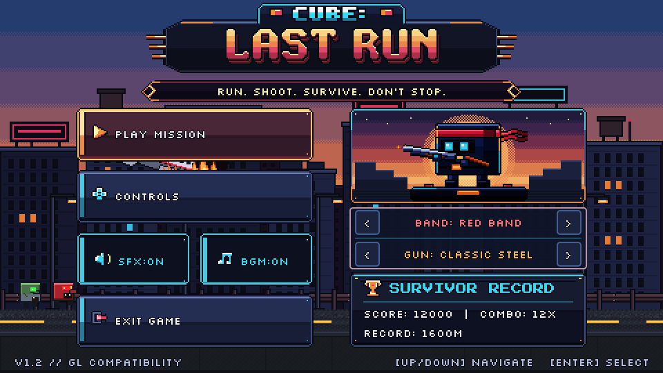
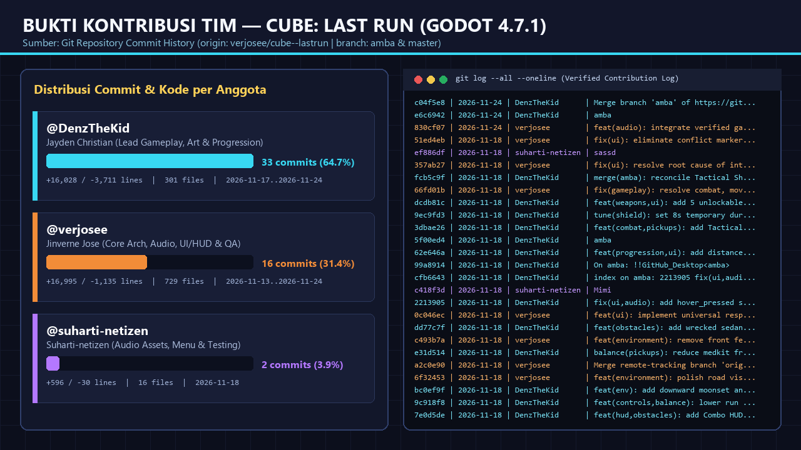
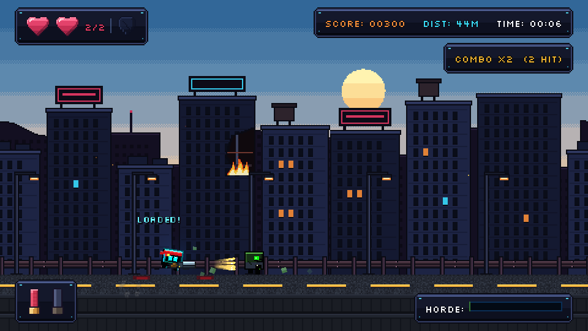
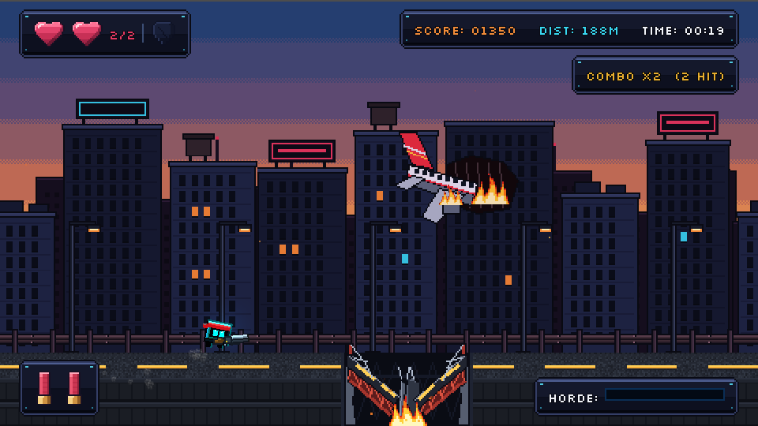
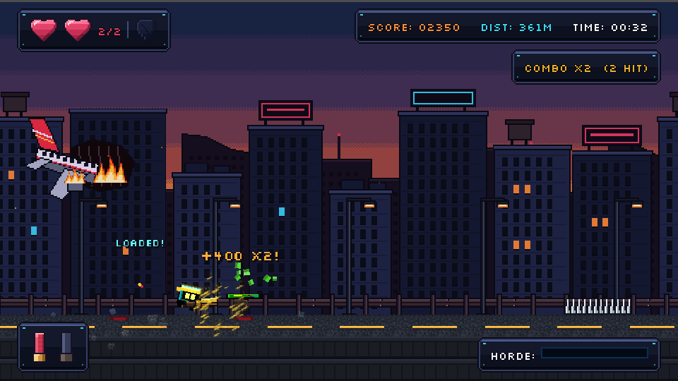
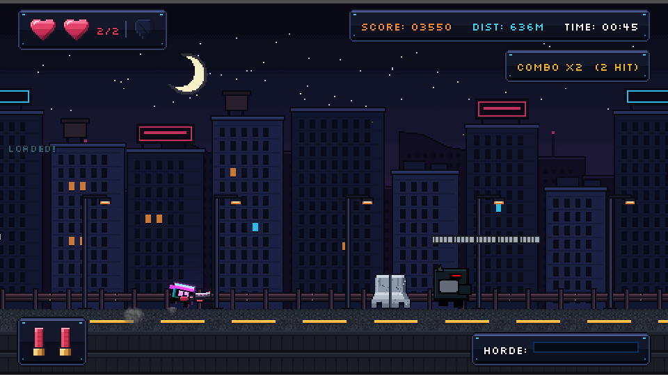
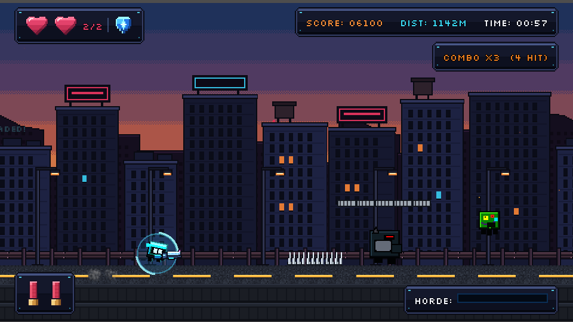
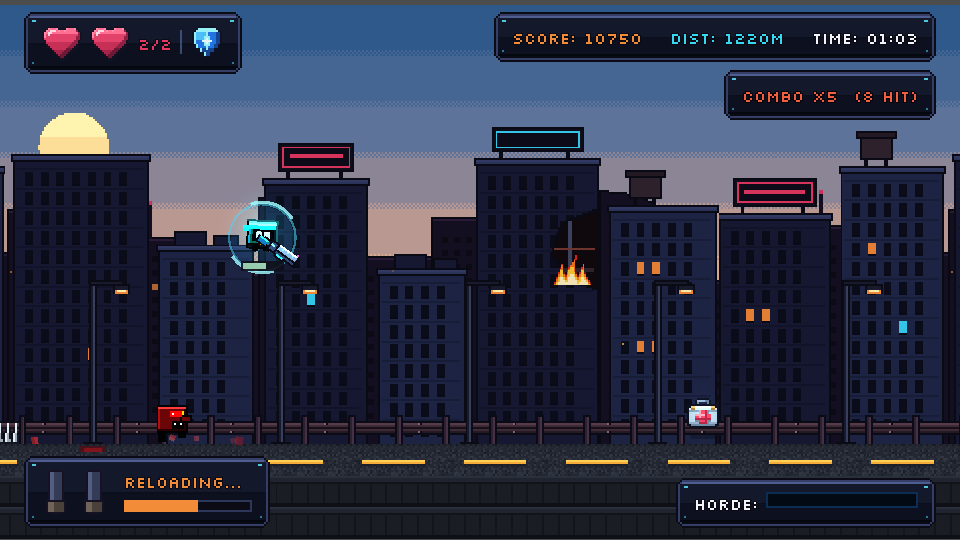
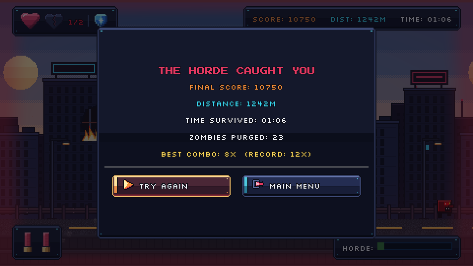

# CUBE: LAST RUN — Final Submission (Godot 4.7.1)

> **Run. Shoot. Survive. Don't Stop.**  
> Game 2D *Apocalyptic Side-Scrolling Action Runner* berbasis **Godot Engine 4.7.1 (GDScript)** dengan bidikan shotgun 360° mulus, fisika *recoil-jump*, 5 zona progresif, siklus langit 24 jam, dan 26 pola rintangan prosedural.

---

## Ringkasan Pengumpulan (Final Submission Checklist)

Seluruh komponen berikut disusun sesuai **Ketentuan Pengumpulan & Catatan**:

| No | Ketentuan Pengumpulan | Status | Tautan / Lokasi File |
|---|---|---|---|
| **1** | **Proyek Godot Lengkap** (`project.godot`, `scenes/`, `scripts/`, `assets/`, `shaders/`) | Lengkap & Terverifikasi | Root repository ini ([`project.godot`](project.godot)) |
| **2** | **Link Game di itch.io + Build Hasil Export** (Main di Browser & Windows `.exe`) | Tersedia (Public) | **https://denzthekid.itch.io/cube-last-run** & [`builds/Cube_LastRun_Windows_x64.zip`](builds/Cube_LastRun_Windows_x64.zip) |
| **3** | **Laporan Lengkap (PDF & PPT)** berisi anggota, pembagian tugas, level, dan fitur | Tersedia (PDF + PPTX) | [`laporan/Laporan_Final_CUBE_LAST_RUN.pdf`](laporan/Laporan_Final_CUBE_LAST_RUN.pdf) & [`laporan/Presentasi_Final_CUBE_LAST_RUN.pptx`](laporan/Presentasi_Final_CUBE_LAST_RUN.pptx) |
| **4** | **Bukti Kontribusi + Screenshot Setiap Level** | Tersedia | [`laporan/bukti_kontribusi_git.png`](laporan/bukti_kontribusi_git.png), tab [Contributors](../../graphs/contributors), & [`laporan/screenshots/`](laporan/screenshots/) |
| **5** | **Video Gameplay Seluruh Level (5 Level)** — YouTube (Unlisted) | Tersedia | **https://youtu.be/xP-9e2LzxnY** |

---

## Video Gameplay (YouTube — Full 5 Levels, 1080p HD)

- **Link YouTube:** **https://youtu.be/xP-9e2LzxnY**
- **Timestamp Chapter:**
  - `00:00` — Main Menu & Hero/Weapon Skin Loadout Showcase
  - `00:05` — **Level 1:** Outbreak Warmup *(Base Tier | Day)*
  - `00:19` — **Level 2:** Highway Collapse *(Mid Tier | Afternoon | Collapsed Bridge Pit)*
  - `00:32` — **Level 3:** Infected Escalation *(High Tier | Dusk | Brute, Mutant & Shield)*
  - `00:45` — **Level 4:** Midnight Gauntlet *(Expert Tier | Full Night + Crescent Moon)*
  - `00:57` — **Level 5:** Dawn Survival & Endgame Finale *(Master Tier | Sunrise & Game Over)*

---

## Anggota Kelompok & Pembagian Tugas

| Anggota / Akun GitHub | Peran Utama | Pembagian Tugas & Kontribusi | Statistik Git |
|---|---|---|---|
| **Jayden Christian** (`@DenzTheKid`) | Lead Gameplay, Environment Art & Progression | Mekanik bidikan 360° & *recoil-jump*, 5 Hero Skins & 5 Shotgun Skins + loadout selector, Tactical Shield & Arcade Callouts, rintangan kendaraan (Sedan, Police, Ambulance, Bus, Jersey Barrier), Jembatan Roboh + api animasi 8-frame, landmark Pesawat Jatuh langka, siklus 24 jam Siang–Malam–Fajar. | 33+ commits (`+16,028 / -3,711` lines) |
| **Jinverne Jose** (`@verjosee`) | Core Architecture, Audio, UI/HUD & QA Lead | Arsitektur inti Godot 4, integrasi paket Audio terverifikasi (SFX, BGM crossfade, ambient highway wind), layout HUD responsif di 8 resolusi (4:3, 16:9, 16:10, 21:9), perbaikan UI freeze/focus deadlock, alignment jalan & guardrail, serta Automated QA & Regression Audit. | 16 commits (`+16,995 / -1,135` lines) |
| **Suharti-netizen** (`@suharti-netizen`) | Audio Assets, Main Menu & QA Verification | Kontribusi aset audio proyek (`assets/audio/`), pembaruan scene & skrip Main Menu (`main_menu.tscn`, `main_menu.gd`), serta verifikasi import screenshot HUD multi-resolusi. | 2 commits (`+596 / -30` lines) |

### Bukti Kontribusi (Verified Git History)
Riwayat commit asli seluruh anggota tim dipertahankan utuh di repository ini dan dapat diverifikasi langsung pada menu **Commits** & **Insights → Contributors**.

---

## Rancangan 5 Level (Zona Progresif) & Screenshot

### Level 1 — Outbreak Warmup *(Zone 1: 0–100m | Base Tier | Day)*
Zona pemanasan di jalan tol kota pasca-kiamat pada siang hari. Memperkenalkan *auto-run*, lompatan, bidikan shotgun 360°, serta rintangan awal (Walker, Runner, Spike Hurdle, Barricade, Wrecked Sedan, Bus Wreck).

### Level 2 — Highway Collapse *(Zone 2: 100–250m | Mid Tier | Afternoon)*
Jalan tol mulai runtuh dengan lubang jurang berisi **Jembatan Roboh yang terbakar api animasi**, Police Roadblock, Twin Runners, Double Spikes, dan mobil Ambulans dengan Medkit (+1 HP).

### Level 3 — Infected Escalation *(Zone 3: 250–450m | High Tier | Sunset / Dusk)*
Eskalasi ancaman di langit senja lengkap dengan landmark langka **gedung tertabrak pesawat komersial**, musuh berat **Armored Brute Tank (4 HP)** & **Leaping Mutant**, pickup **Tactical Shield**, serta unlock skin *Solar Gold* & *Royal Gold*.

### Level 4 — Midnight Gauntlet *(Zone 4: 450–1000m | Expert Tier | Full Night & Moon)*
Pertarungan tengah malam diterangi bulan sabit, visor neon, dan kilatan moncong shotgun. Membuka pola tersulit (*The Gauntlet*, *Barricade + Brute*, *Recoil Double Vault*, *High Runner Ambush*).

### Level 5 — Dawn Survival & Endgame *(Zone 5: 1000m+ | Master Tier | Sunrise)*
Fase bertahan hidup kecepatan maksimal saat fajar menyingsing. Seluruh 26 pola rintangan aktif dengan pengejaran agresif **Rear Horde** (`HORDE PUSHBACK!`) dan loadout endgame *Neon Cyan* + *Cyber Plasma*.

### Aksi Recoil-Vault & Layar Game Over
| Mid-Air Shield + Reload & Combo x5 | Layar Game Over (Mission Telemetry) |
|---|---|
|  |  |

---

## Fitur Utama & Kontrol

- **360° Continuous Aiming & Recoil-Jump Physics:** Bidikan shotgun bebas 360° (Mouse, Keyboard, Gamepad); tembakan ke arah bawah melontarkan karakter ke udara (*Recoil Vault*) untuk melompati jembatan runtuh & rintangan tinggi.
- **26 Modular Procedural Patterns + Fairness Validation:** Generator level modular yang memvalidasi keadilan jarak lompatan dan mencegah bahaya fatal berturut-turut.
- **4 Kelas Zombie + Rear Horde Pursuer:** Walker, Runner, Mutant (melompat), Brute Tank (4 HP), serta gerombolan belakang (*Rear Horde*).
- **Mix-and-Match Skin Loadout:** 5 Skin Karakter (*Red Band, Venom Lime, Solar Gold, Shadow Violet, Neon Cyan*) & 5 Skin Shotgun (*Classic Steel, Crimson Ops, Venom Bio, Royal Gold, Cyber Plasma*).
- **Tactical Shield, Medkit & Arcade Callouts:** Perisai sementara 8 detik, Medkit pemulih HP, Combo Multiplier hingga `x5`, dan callout (`AIRSHOT`, `POINT BLANK`, `HORDE PUSHBACK`).
- **24-Hour Dynamic Sky & Apocalyptic Parallax City:** Siklus langit penuh 24 jam, kota parallax 4 lapis atmosferik, api animasi 8-frame stabil, jembatan roboh, dan pesawat jatuh langka (1 per 6 blok).

| Aksi | Keyboard & Mouse | Gamepad |
|---|---|---|
| Lompat (*Jump*) | `Space` / `W` | `A` / Cross |
| Turun Cepat (*Fast-Fall*) | `S` / `Down Arrow` (di udara) | `B` / D-Pad Down |
| Bidikan 360° (*Aim*) | Mouse / Tombol Panah | Right Analog Stick |
| Tembak / *Recoil Jump* | Klik Kiri / `X` / `J` | `R2` / Right Trigger |
| Reload Manual | `R` *(otomatis saat habis)* | `X` / Square |
| Pause | `Esc` / `P` | `Start` / Options |

---

## Cara Menjalankan Game

### 1. Main Langsung di Browser (itch.io — Tanpa Instalasi)
- Klik langsung: **https://denzthekid.itch.io/cube-last-run** → tekan **Run game** (mendukung layar penuh / *Fullscreen*).

### 2. Langsung Main di Windows (Standalone `.exe` — Tanpa Godot)
1. Unduh [`builds/Cube_LastRun_Windows_x64.zip`](builds/Cube_LastRun_Windows_x64.zip).
2. Ekstrak file ZIP lalu jalankan **`Cube_LastRun.exe`**.

### 3. Build Web HTML5 Lokal
- Seluruh file export HTML5 (`index.html`, `index.js`, `index.wasm`, `index.pck`) tersedia di folder [`builds/web/`](builds/web/) dan dapat dijalankan via web server lokal (`py -m http.server`).

### 4. Membuka Proyek di Godot Engine 4.7.1
1. Clone atau unduh repository ini.
2. Buka **Godot Engine 4.7.1** → **Import** → pilih [`project.godot`](project.godot).
3. Tekan **F5** untuk menjalankan game dari Main Menu.

---

## Hasil Uji Otomatis (QA & Regression Audit)
- `scenes/tools/test_runner.tscn`: **34 / 34 PASSED** (0 Failed, 0 Runtime Errors, RAM ~55.2 MB)
- `scenes/tools/regression_audit_runner.tscn`: **26 / 26 PASSED** (0 Failed — Validasi damage, fisika recoil, fairness 26 pola, HUD lintas 8 resolusi)
